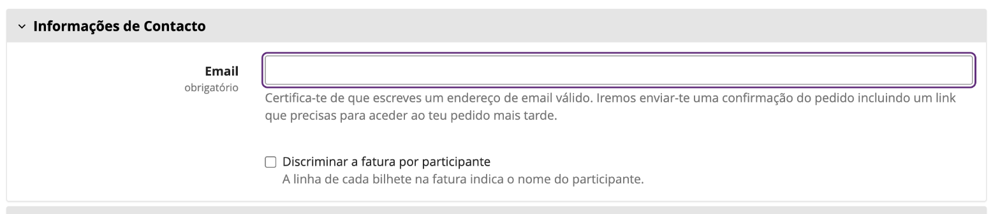

# Configuração

Está tudo numa página: **Configurações → Faturação PT** do evento. (Chama-se "PT" para se distinguir
da entrada "Facturação" do próprio pretix, que configura as faturas internas do pretix.) Para uma
primeira configuração guiada, comece pelos [Primeiros passos](getting-started.md); esta página é a
referência de cada opção.

## Geral

| Definição | Por omissão | Descrição |
|---|---|---|
| **Serviço de faturação** | nenhum | Os cartões: **Sem faturação**, [Fact.pt](factpt.md) ou [Moloni](moloni.md). Sem nenhum, nada é emitido. Só a secção do serviço selecionado é mostrada, guardada e usada. |
| **Emitir documentos automaticamente** | ligado | Emite a fatura-recibo quando a encomenda é paga e a nota de crédito quando é totalmente reembolsada. Desligue para um modo só manual: nada é emitido a não ser pelos botões da página da encomenda. Veja [Emissão só manual](#emissao-so-manual). |
| **O campo personalizado da morada de faturação contém o NIF do comprador** | desligado | Pede o NIF a todos os compradores, não só às empresas. Veja [NIF](#nif). |
| **Permitir ao comprador discriminar a fatura por participante** | desligado | Acrescenta uma opção ao formulário de contacto do checkout. Quando o comprador a marca, cada bilhete ganha a sua própria linha na fatura, com o nome do participante. Veja [Linhas da fatura](#linhas-da-fatura). |
| **Mostrar a fatura na página da encomenda do comprador** | ligado | Acrescenta botões para descarregar a fatura e eventuais notas de crédito junto às descargas dos bilhetes. O PDF passa pelo pretix, por isso as credenciais do serviço nunca chegam ao browser. |

## E-mail

Os e-mails de encomenda do próprio pretix não conseguem anexar estes documentos (só anexam as faturas
do próprio pretix), por isso o plugin envia os seus, um por documento.

| Definição | Por omissão | Descrição |
|---|---|---|
| **Enviar a fatura-recibo por e-mail ao comprador** | desligado | Envia o PDF assim que a fatura-recibo é emitida. |
| **Enviar a nota de crédito por e-mail ao comprador** | desligado | Envia o PDF assim que a nota de crédito é emitida; o texto indica a fatura que anula. |

Emitir à mão no Control também envia o e-mail. Se cada documento seguiu ou não aparece na sua linha
do painel **Faturação PT** da encomenda (*Enviada por e-mail ao comprador* / *Não foi possível
enviá-la por e-mail ao comprador*). Um e-mail que falhe fica no log e nunca marca a emissão como
falhada: o documento já existe no serviço.

## Definições do serviço

Por baixo da secção E-mail vem a secção do serviço selecionado. Cada um tem a sua página:

- [Fact.pt](factpt.md#definicoes): token da API, sandbox, taxa de IVA, unidade e tipo de item.
- [Moloni](moloni.md#definicoes): a ligação, a empresa, as séries de documentos, o IVA, as formas de
  pagamento e os valores por omissão dos artigos.

Alguns campos (taxa de IVA, empresa, série de documentos…) passam a listas preenchidas em direto a
partir da sua conta, assim que as credenciais escritas são válidas, sem precisar de guardar
primeiro. Os campos que dependem de outro (as definições por empresa do Moloni) voltam a carregar
quando esse muda. Se a consulta falhar, a linha por baixo da secção diz porquê, e os campos ficam
como caixas simples com os valores guardados.

!!! info "Ainda não está em uso"
    Escolher o cartão de um serviço não chega. Até a página ser guardada com tudo o que o serviço
    precisa, a sua secção mostra um aviso azul *Ainda não está em uso* e nada é emitido por ele. O
    aviso desaparece quando o serviço está selecionado e totalmente configurado.

Os campos das definições indicam aos browsers e gestores de palavras-passe (Bitwarden, 1Password,
LastPass, Dashlane) que não os preencham automaticamente, para que o seu login do pretix nunca acabe
nas credenciais de um serviço.

## NIF

Por omissão, o NIF do comprador é lido do campo **Número de IVA** da morada de faturação do pretix.
O pretix só mostra esse campo a clientes empresa, por isso os particulares não têm onde indicar o
NIF e são faturados como consumidor final.

Para o pedir a toda a gente:

1. Em **Configurações → Facturação** do pretix, abra o separador **Formulário de endereço** e
   preencha **Custom recipient field label**, por exemplo com `NIF`. Tem de ser pedida uma morada de
   faturação (**Pedir endereço de facturação**) para o formulário aparecer.

    

2. Ligue aqui **O campo personalizado da morada de faturação contém o NIF do comprador**.

O campo personalizado passa a ser usado sempre que o campo Número de IVA está vazio, e torna-se o
**único campo de NIF** no checkout:

- O campo de *referência interna* do pretix, que a tradução portuguesa do próprio pretix chama "NIF
  (Número de Contribuinte)" para empresas, fica escondido, para não haver uma segunda caixa "NIF".
- Em moradas portuguesas o campo **Número de IVA** do pretix também fica escondido, para empresas
  inclusive. Um comprador de outro país da UE continua a vê-lo, porque a autoliquidação precisa dele.

Os números são aceites com espaços, pontos ou traços e com o prefixo `PT` (`PT 237.892.294` serve).
Os NIF portugueses cujo dígito de controlo não confira são ignorados, não são enviados, por isso uma
gralha dá um documento a consumidor final em vez de um documento recusado.

Sem NIF, o documento é emitido a **consumidor final** (`999999990`). Um comprador que não indicou
nome nem empresa é faturado como "Consumidor Final", nunca pelo e-mail.

!!! warning "Não torne o Número de IVA obrigatório"
    Com o campo personalizado como NIF, a opção **Exigir número de IVA** do próprio pretix recusaria
    as empresas portuguesas, porque o campo que teriam de preencher está escondido. Deixe-a desligada.

## Linhas da fatura

Cada documento leva todas as posições não canceladas **e todas as taxas** da encomenda (taxa de
pagamento, de serviço, de envio…), por isso o seu total é o total da encomenda.

- Bilhetes iguais (mesmo produto, preço e taxa) partilham uma linha com quantidade.
- Com **Permitir ao comprador discriminar a fatura por participante** ligado e a opção marcada no
  checkout, cada bilhete ganha a sua linha, chamada `<produto> — <nome do participante>`.

    

- Cada linha mostra o nome do produto no pretix e o preço efetivamente pago.

Os serviços recebem preços unitários **sem IVA** e acrescentam-lhes o IVA configurado. Os preços do
pretix são com IVA, por isso o valor sem IVA é calculado a 8 casas decimais e escolhido de forma a
que o total do documento seja exatamente o que o comprador pagou, ao cêntimo, mesmo com várias
linhas à mesma taxa.

## Emissão só manual

Com **Emitir documentos automaticamente** desligado, pagar uma encomenda ou concluir um reembolso
não emite nada. Os documentos saem só dos botões do painel **Faturação PT** da encomenda: **Emitir
fatura agora** e **Emitir nota de crédito**. Tudo o resto funciona da mesma forma, incluindo os
e-mails e as descargas do comprador.

Útil para um evento em que só algumas encomendas precisam de documento oficial, ou enquanto ainda
está a conferir o que o serviço emite.

## Alterações aos dados de faturação depois de faturar

Cada documento emitido guarda os dados de faturação com que foi passado (nome, NIF, morada). Se o
comprador editar depois a morada de faturação na página da encomenda, o plugin compara os dois e,
quando diferem:

- o painel **Faturação PT** da encomenda mostra um aviso com o número da fatura;
- o **e-mail de contacto** do evento (pretix **Configurações → Geral**) recebe uma mensagem com uma
  ligação para a encomenda.

Nada é creditado nem reemitido sozinho. Para aceitar a alteração, carregue em **Emitir nota de
crédito** e depois em **Emitir fatura agora** na página da encomenda; a nova fatura usa os dados
novos. O e-mail repete-se a cada gravação posterior enquanto os dados continuarem diferentes. Os
documentos emitidos por versões do plugin anteriores à 0.7 não têm estes dados guardados e nunca
avisam.
