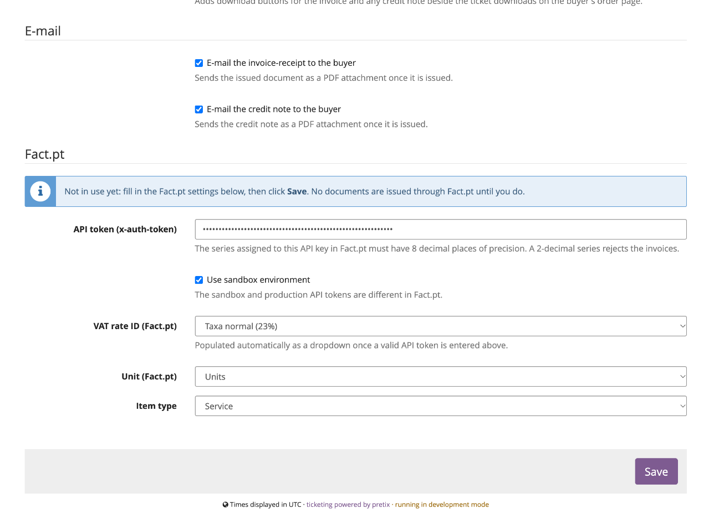

# Fact.pt

Serviço [Fact.pt](https://fact.pt) — identificador `factpt`. Verificado com uma conta sandbox real do
Fact.pt.

## Configurar o Fact.pt

### No Fact.pt

1. Crie uma chave da API no Backoffice do Fact.pt. A chave fica associada a uma série de documentos.
2. Confirme que essa série tem **8 casas decimais** de precisão. O plugin envia preços unitários sem
   IVA com várias casas decimais para as faturas baterem certo ao cêntimo; uma série de 2 casas
   decimais recusa-os (`price: Trying to use an item having more than 2 decimal digits, in an
   incompatible series.`).
3. Para testar, faça o mesmo na [sandbox](https://api.sandbox.fact.pt). Os tokens de sandbox e de
   produção são diferentes.

### No pretix

Abra **Configurações → Faturação PT** do evento, clique no cartão **Fact.pt** e preencha a sua
secção:



1. Cole o **Token da API (x-auth-token)**.
2. Marque **Usar ambiente de testes (sandbox)** enquanto testa. Desmarque, e cole o token de
   produção, quando passar a produção.
3. **ID da taxa de IVA (Fact.pt)** passa a uma lista das taxas ativas da sua conta assim que o
   token é válido. Escolha a taxa que o pretix cobra nos bilhetes do evento; veja [A taxa de IVA
   tem de coincidir com a do pretix](#a-taxa-de-iva-tem-de-coincidir-com-a-do-pretix).
4. Escolha uma **Unidade** e um **Tipo de item**. Para bilhetes, *Unidades* e *Serviço* é a escolha
   habitual.
5. Carregue em **Guardar**. O aviso *Ainda não está em uso* desaparece, e as encomendas pagas passam
   a ser faturadas.

## Definições

| Definição | Descrição |
|---|---|
| **Token da API (x-auth-token)** | O seu token da API do Fact.pt. A série dele tem de ter 8 casas decimais. |
| **Usar ambiente de testes (sandbox)** | Emite em `api.sandbox.fact.pt`. Os tokens de sandbox e de produção são diferentes. |
| **ID da taxa de IVA (Fact.pt)** | Lista das taxas ativas da sua conta, carregada em direto quando o token é válido. Aplicada a todas as linhas. |
| **Unidade (Fact.pt)** | Unidades / Metros / Caixas / Kilos / Litros. |
| **Tipo de item** | *Serviço* ou *Produto*. |

## A taxa de IVA tem de coincidir com a do pretix

O Fact.pt recebe o preço **sem IVA** de cada linha e acrescenta-lhe a taxa configurada. Se essa taxa
for diferente da que o pretix cobrou, o documento ficaria com um valor que o comprador nunca pagou
(por exemplo, um bilhete de 15,00 € sem regra de IVA no pretix, faturado a 23%, passa a 18,45 €).

Por isso, antes de cada emissão, o plugin compara a taxa configurada com a taxa do pretix em cada
linha e **recusa com um erro explícito** se não coincidirem:

```
Divergência de IVA: o pretix cobrou 0% nesta encomenda mas a taxa configurada no Fact.pt é 23%
(Taxa normal (23%)). A fatura seria emitida com o valor errado. Corrija a regra de IVA do evento
ou a definição da taxa de IVA do Fact.pt.
```

Corrija a regra de IVA ou a definição e carregue em **Tentar novamente**.

!!! note "Nota"
    Uma taxa de IVA por evento: um evento que venda artigos a taxas diferentes ainda não pode ser
    faturado. Veja as [Limitações conhecidas](limitations.md).

## Clientes

- **Com NIF** — é reutilizado um cliente do Fact.pt com exatamente esse NIF. Caso contrário, é criado
  um (ou atualizado, se o Fact.pt já tiver esse NIF) a partir da morada de faturação da encomenda.
- **Sem NIF** — é reutilizado um cliente consumidor final com o mesmo nome; caso contrário, o
  Fact.pt cria um com o NIF `999999990`. Um comprador sem nome nem empresa fica registado como
  "Consumidor Final".

Uma morada portuguesa sem código postal é enviada com `0000-000`, que o Fact.pt aceita onde um
código vazio é recusado. Os campos da morada são reduzidos a uma linha e cortados aos limites do
Fact.pt.

!!! warning "Clientes duplicados"
    Se vários clientes do Fact.pt tiverem o NIF do comprador, a emissão pára com
    `Multiple clients with same tin. Specify an ID.` O plugin não adivinha a qual deles faturar:
    junte os duplicados no Backoffice do Fact.pt e tente novamente.

Um cliente criado ou atualizado a partir do pretix substitui a ficha desse NIF no Fact.pt com os
dados da morada da encomenda.

## Proteção contra duplicados e novas tentativas

Cada documento leva um `identifierId` (`pretix-<evento>-<código da encomenda>`), e o Fact.pt recusa
um segundo documento com o mesmo. É isso que torna as novas tentativas seguras: uma falha de rede
(timeout, Fact.pt inacessível) é **repetida automaticamente**, até três vezes com uns minutos de
intervalo, e se o primeiro pedido tiver afinal chegado, a repetição é recusada em vez de emitir em
duplicado. Entretanto a linha diz *nova tentativa automática dentro de alguns minutos*, e *desistiu
ao fim de várias tentativas* se todas falharem; carregue então em **Tentar novamente**.

Uma recusa (token errado, divergência de IVA, dados inválidos) nunca é repetida automaticamente:
corrija a causa e carregue em **Tentar novamente**.

Uma encomenda [paga de novo depois de um reembolso](usage.md#paga-de-novo-depois-de-um-reembolso)
recebe um novo identificador por cada nova fatura (`…-r1`, `…-r2`), e cada nota de crédito usa o da
sua fatura seguido de `-credit`.

## Notas de crédito

Emitidas com o endpoint de crédito do Fact.pt, creditando o documento original na totalidade. O
Fact.pt só permite uma nota de crédito por documento, pelo valor total.

## Documentos e números

O número mostrado no pretix (por exemplo `2025QG/9`) é o que o Fact.pt devolve para o documento. As
linhas emitidas pelo Fact.pt oferecem também **Abrir no Fact.pt**, uma ligação para a página
permanente do documento.
