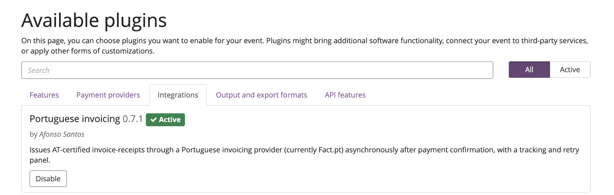
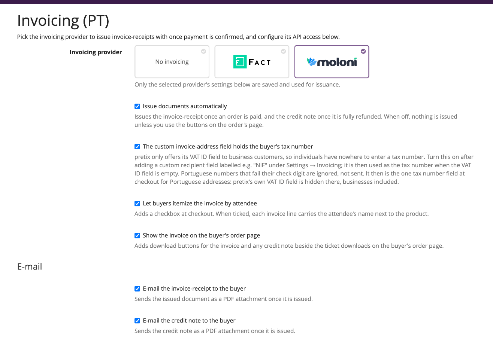
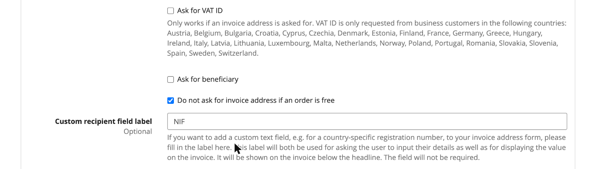
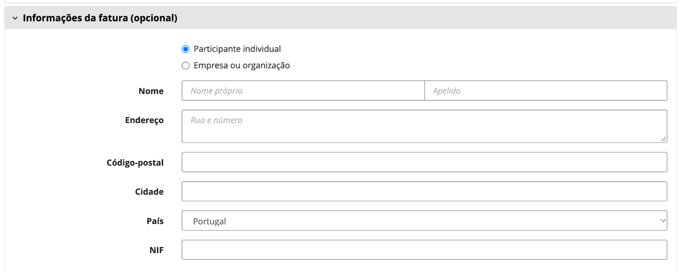
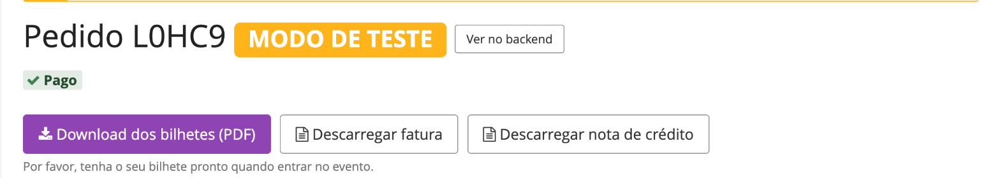
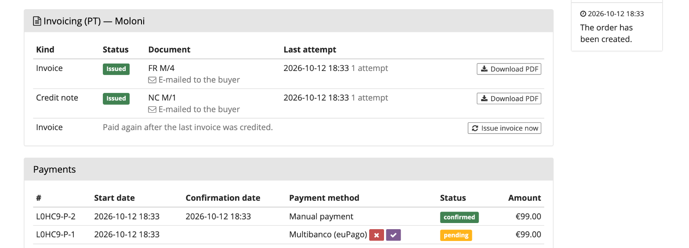

# Getting started

From a fresh install to the first invoice-receipt, step by step. Budget about half an hour, most of
it on the provider's side.

**Before you start**, have at hand:

- a **pretix** instance (≥ 2024.1) you can install packages into, with Celery workers running;
- a provider account: a [Fact.pt](https://fact.pt) API token tied to a series with **8 decimal
  places**, or a [Moloni](https://moloni.pt) account with a developer app (see each provider's
  page for what exactly to create there);
- the VAT rate your tickets are sold at, as configured under the event's **Settings → Taxes**.

## 1. Install the plugin

Install it into the same Python environment pretix runs from, apply its migration, and restart both
the web server and the Celery workers (plugins are only discovered at startup):

```bash
pip install pretix-pt-invoicing
python -m pretix migrate
```

## 2. Enable it for the event

Open the event's **Settings → Plugins**, switch to the **Integrations** tab and press **Enable** on
**Portuguese invoicing**.



Two new entries appear in the event's sidebar: **Settings → Invoicing (PT)**, where the plugin is
configured, and **Invoicing (PT)** further down, the dashboard of every document issued. Both are
labelled "(PT)" to tell them apart from pretix's own "Invoicing" entries, which concern pretix's
internal invoices, not these.

## 3. Pick a provider

Open **Settings → Invoicing (PT)** and click the card of the provider you'll issue through. Only
the selected provider's settings are shown, saved and used.



Leave the general options at their defaults for now. They are explained in
[Configuration](configuration.md); the one you will probably want later is **The custom
invoice-address field holds the buyer's tax number**, set up in step 6.

!!! info "Not in use yet"
    Picking a card only shows that provider's settings. Until you press **Save** with everything the
    provider needs filled in, a blue notice at the top of its section says *Not in use yet*, and no
    document is issued through it.

## 4. Connect the provider

Fill in the provider's section at the bottom of the same page, then press **Save**. Each provider has
its own walkthrough:

- [Setting up Fact.pt](factpt.md#setting-up-factpt): paste the API token, tick **Use sandbox
  environment** while testing, pick the VAT rate from the dropdown that appears.
- [Setting up Moloni](moloni.md#setting-up-moloni): register the redirect URI in a Moloni developer
  app, press **Connect to Moloni**, then pick the company, document series and the rest from the
  dropdowns.

Dropdowns such as the VAT rate or the company are filled live from your provider account as soon
as the credentials you typed are valid, so there is no need to save first to see them. If a field
stays a plain number box, the status line under the section says why (bad token, provider
unreachable).

## 5. Match the VAT rate

Both providers receive each line's **net** price and add their own configured rate on top. The
plugin therefore refuses to issue when the provider's rate differs from the rate pretix charged,
rather than issue a document for an amount the buyer never paid.

Check that the rate you picked in step 4 is the one on the event's tax rule (**Settings → Taxes**).
An event selling tickets at several rates can't be invoiced yet; see
[Known limitations](limitations.md).

## 6. Collect the buyer's NIF

pretix only asks business customers for a VAT ID, so a private buyer has nowhere to type a NIF and
would be invoiced as a final consumer. To collect it from everyone:

1. Under pretix's **Settings → Invoicing**, open the **Address form** tab and fill in **Custom
   recipient field label** with `NIF`. Make sure an invoice address is asked for at all (**Ask for
   invoice address**).

    

2. Back under **Settings → Invoicing (PT)**, tick **The custom invoice-address field holds the
   buyer's tax number** and save.

At checkout the buyer now sees one **NIF** field in the invoice address form, whether they buy as an
individual or as a company. For Portuguese addresses pretix's own VAT ID field is hidden, so there
is never a second place to type the number.



See [Tax numbers (NIF)](configuration.md#tax-numbers-nif) for how the number is validated and what
happens without one.

## 7. Choose what the buyer gets

Still under **Settings → Invoicing (PT)**:

- **E-mail the invoice-receipt to the buyer** and **E-mail the credit note to the buyer** send
  each document as a PDF attachment once it's issued. Both are off by default; pretix's own order
  e-mails can't carry these documents.
- **Show the invoice on the buyer's order page** (on by default) adds download buttons beside the
  ticket downloads.



## 8. Issue a test document

Keep the event in **test mode** and the provider in its sandbox (Fact.pt) or a test company
(Moloni) for this.

1. Buy a ticket in the shop and mark the order as paid in the Control panel, or just mark any
   existing test order as paid.
2. Open the order. Its **Invoicing (PT)** panel shows the invoice row within a few seconds, with the
   document number and a **Download PDF** button.

    

3. Open the PDF and check the **total**, the **VAT** split, and the **client** (name and NIF). If
   the order was paid before the plugin was set up, use **Issue invoice now** in the same panel.

The **Invoicing (PT)** dashboard in the sidebar lists every document of the event, with its status
and any error. [Issuing & credit notes](usage.md) explains the rest: credit notes, retries, and
what each failure means.

## 9. Go live

- Fact.pt: paste the **production** token and untick **Use sandbox environment**. The tokens are
  different.
- Moloni: connect to the real company, and pick its real document series.
- Take the event out of test mode.

!!! warning "Before production"
    Issue a few test documents in the provider's sandbox first and check the amounts, client and
    tax data on the PDFs. Once issued, a document is reported to the tax authority and can only be
    cancelled with a credit note.
