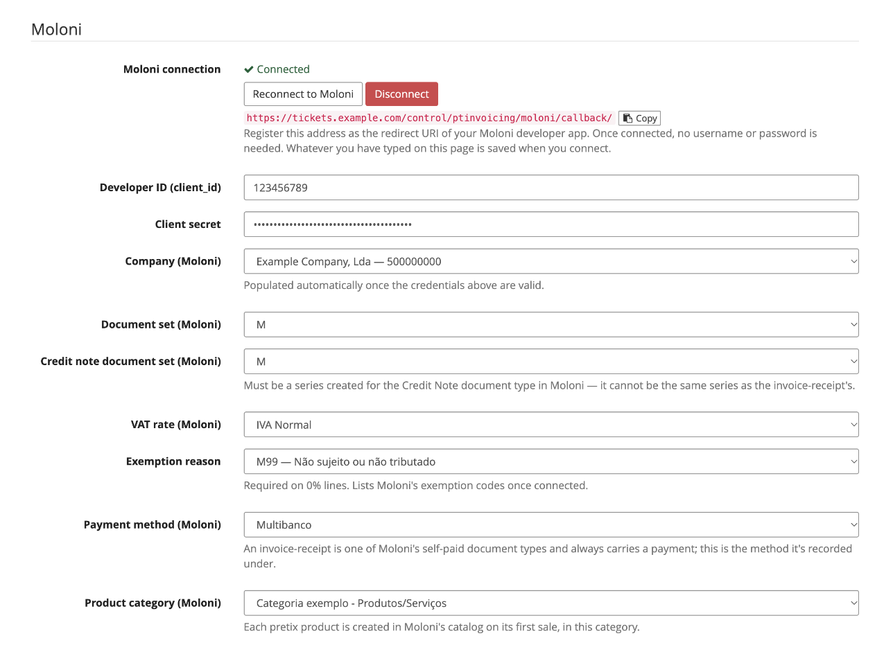
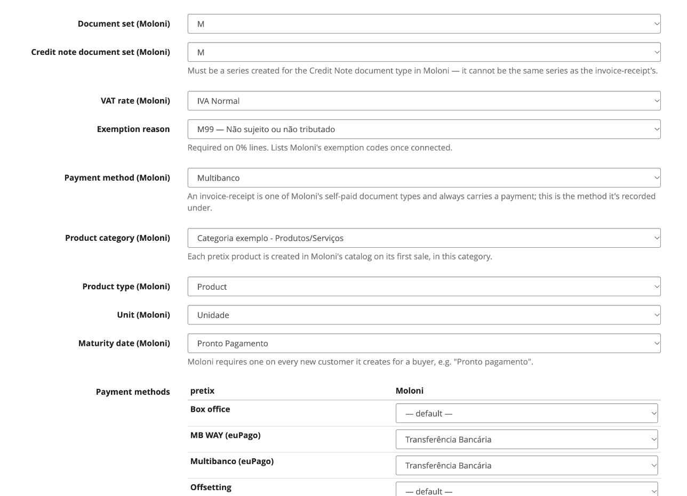
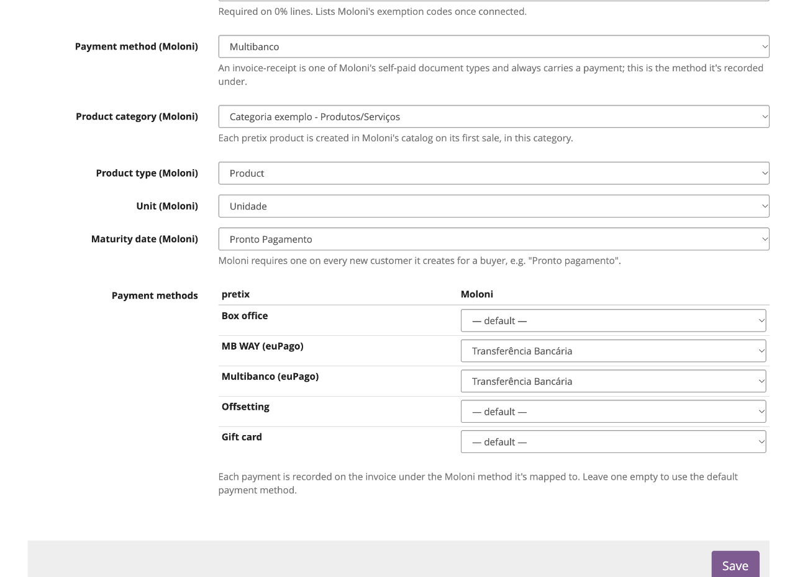

# Moloni

Serviço [Moloni](https://moloni.pt) — identificador `moloni`. A emissão de faturas-recibo e notas de
crédito, e a descarga dos respetivos PDF, foram verificadas com uma conta real do Moloni.

## Configurar o Moloni

### No Moloni

1. Na área de programador do Moloni, crie uma aplicação. Anote o seu **ID de programador**
   (client_id) e o **Segredo do cliente**.
2. Registe nessa aplicação o **redirect URI** do plugin. Aparece (com um botão **Copiar**) na
   página de definições do plugin e é o mesmo para todos os eventos:
   `https://<o seu domínio do pretix>/control/ptinvoicing/moloni/callback/`.
3. Na empresa de onde vai faturar, confirme que tem uma série de documentos para
   **faturas-recibo** e outra, separada, para **notas de crédito** (uma série do Moloni está presa
   a um tipo de documento), além de pelo menos uma forma de pagamento e um prazo de vencimento
   ("Pronto pagamento").

### No pretix

Abra **Configurações → Faturação PT** do evento e clique no cartão **Moloni**.

1. Preencha o **ID de programador (client_id)** e o **Segredo do cliente**.
2. Carregue em **Ligar ao Moloni**. É enviado para o Moloni para autorizar a aplicação e depois
   trazido de volta a esta página. O que tiver escrito é guardado pelo caminho; não é preciso
   guardar primeiro. De volta, o painel mostra **Ligado**, com os botões **Voltar a ligar ao
   Moloni** e **Desligar**.
3. Escolha a **Empresa**. Com várias empresas na conta tem de escolher uma explicitamente; cada
   opção mostra o nome e o NIF. As restantes listas carregam para essa empresa.
4. Escolha a **Série de documentos** das faturas-recibo e a **Série de notas de crédito**. Têm de
   ser séries diferentes, a segunda criada para o tipo de documento *Nota de Crédito*.
5. Escolha a **Taxa de IVA** que o pretix cobra nos bilhetes e um **Motivo de isenção** se algum
   bilhete for vendido a 0%. Veja [IVA](#iva).
6. Escolha a **Forma de pagamento** por omissão, um **Prazo de vencimento**, e a **Categoria de
   artigos**, o **Tipo de artigo** e a **Unidade** com que os artigos de catálogo do plugin são
   criados.

    

7. Opcionalmente, associe cada forma de pagamento do pretix a uma do Moloni na tabela **Formas de
   pagamento**. Veja [Formas de pagamento](#formas-de-pagamento).

    

8. Carregue em **Guardar**. Até o fazer, a secção diz *Ainda não está em uso* e nada é emitido.

## A ligação

**Ligar ao Moloni** usa o fluxo de autorização do Moloni: não é guardada nenhuma palavra-passe do
Moloni, só os tokens de acesso. O refresh token expira ao fim de **14 dias sem uso**, por isso o
plugin renova-o todos os dias em cada evento ligado ao Moloni, e um evento sem vendas nunca perde a
ligação.

Se o Moloni recusar a renovação, a ligação fica **expirada**: a página de definições indica-o, os
painéis das encomendas avisam que nada pode ser emitido, e o **e-mail de contacto** do evento
(pretix **Configurações → Geral**) recebe uma mensagem com uma ligação para voltar a ligar. Carregue
em **Voltar a ligar ao Moloni**.

**Desligar** pede confirmação primeiro, porque sem ligação não é possível emitir nenhum documento
para o evento.

!!! note "Utilizador e palavra-passe"
    Continuam a ser aceites como alternativa a **Ligar ao Moloni**, e ficam escondidos enquanto
    estiver ligado. Se estiverem preenchidos, uma ligação expirada volta a entrar sozinha, sem esperar
    que volte a ligar.

## Definições

A maioria dos campos passa a lista, preenchida a partir da sua conta Moloni, depois de ligado. Os
campos de cada empresa carregam depois de escolher a **Empresa**.

| Definição | Obrigatória | Descrição |
|---|---|---|
| **ID de programador (client_id)** | sim | Da área de programador do Moloni. |
| **Segredo do cliente** | sim | Da área de programador do Moloni. |
| **Utilizador / palavra-passe Moloni** | não | Só sem **Ligar ao Moloni**; ver acima. |
| **Empresa** | sim | Com várias empresas na conta, tem de escolher uma explicitamente. Cada opção mostra o nome e o NIF. |
| **Série de documentos** | sim | Série usada nas faturas-recibo. |
| **Série de notas de crédito** | sim | Uma série criada para o tipo de documento **Nota de Crédito**. Não pode ser a série das faturas-recibo. |
| **Taxa de IVA** | em bilhetes com IVA | Tem de ser a mesma taxa que o pretix cobra; ver [IVA](#iva). |
| **Motivo de isenção** | em bilhetes a 0% | Os códigos de isenção do Moloni, por exemplo `M07` (Artigo 9.º do CIVA). |
| **Forma de pagamento** | sim | Uma fatura-recibo leva sempre um pagamento; é a forma com que fica registado quando a forma de pagamento do pretix não tem associação própria. |
| **Categoria de artigos** | sim | Onde o plugin cria os artigos do catálogo; ver [Artigos](#artigos). Só aparecem as categorias de topo. |
| **Tipo de artigo** | sim | *Serviço* (por omissão) ou *Produto*. |
| **Unidade** | sim | A unidade de medida dos artigos. |
| **Prazo de vencimento** | sim | Usado em cada novo cliente no Moloni, por exemplo "Pronto pagamento". |
| **Formas de pagamento** (tabela) | não | Uma linha por forma de pagamento aceite no evento; ver [Formas de pagamento](#formas-de-pagamento). |

## Formas de pagamento

O Moloni regista um pagamento em cada fatura-recibo. A tabela **Formas de pagamento** lista cada
forma de pagamento aceite no evento (Multibanco, MB WAY, transferência, bilheteira…) e deixa
escolher a forma de pagamento do Moloni com que fica registada. Uma linha deixada em *predefinida*
usa a definição **Forma de pagamento** acima.

Uma encomenda paga por várias formas recebe um pagamento por forma, com o respetivo valor. Uma
encomenda marcada como paga à mão no Control é registada com a forma da sua última outra tentativa
de pagamento (uma referência Multibanco que foi paga mas nunca confirmada automaticamente conta como
Multibanco).

## Artigos

O Moloni só fatura artigos do seu catálogo, por isso cada produto do pretix tem um, criado
automaticamente na primeira venda: na categoria, tipo e unidade escolhidos, com a referência
`pretix-item-<id>`. Cada tipo de taxa (taxa de pagamento, de envio…) também tem um,
`pretix-fee-<tipo>`. São reutilizados daí em diante, por isso os relatórios de vendas do Moloni
continuam separados por tipo de bilhete. Cada linha do documento continua a mostrar o nome do
produto no pretix e o preço efetivamente pago.

## IVA

Cada linha segue o IVA que o pretix efetivamente cobrou:

- **Linha com IVA** — enviada com a **Taxa de IVA** configurada. Se essa taxa não for a que o pretix
  cobrou, a emissão pára com `Divergência de IVA: …` *antes* de criar o que quer que seja no Moloni.
  Caso contrário, o documento teria um valor diferente do que o comprador pagou.
- **Linha a 0%** — enviada sem IVA, com o **Motivo de isenção**. O Moloni exige um, por isso uma
  encomenda com linhas a 0% e sem motivo de isenção definido pára com um erro explícito.

!!! note "Preços unitários no PDF"
    O Moloni guarda os preços unitários com 5 casas decimais e imprime o preço unitário com IVA a
    partir deles. Um preço com IVA de 35,00 € a 23% sai por isso como 34,99999, na melhor das
    hipóteses, porque 35 / 1,23 não acaba. A incidência, o IVA e o total estão certos (28,46 + 6,54 =
    35,00, a mesma divisão que a fatura do próprio pretix mostra). Só preços cujo valor sem IVA são
    cêntimos inteiros ("preço inclui IVA" desligado no pretix) saem limpos.

## Clientes

Um comprador com NIF é associado a um cliente existente no Moloni quando há exatamente um com esse
NIF. Se houver vários, a emissão pára (`O Moloni tem N clientes com o NIF X. Junte-os no Moloni e
tente novamente.`). Caso contrário, é criado um cliente a partir da morada de faturação da
encomenda. Compradores sem NIF partilham um cliente consumidor final (`999999990`), associado pelo
nome.

Um cliente reutilizado **nunca é alterado**. Quando a morada da encomenda difere da que o Moloni tem
na ficha, o documento é emitido com uma morada alternativa, para o PDF mostrar a morada que o
comprador deu nesta encomenda. Os países são procurados no Moloni pelo código ISO.

## Sem nova tentativa automática

O Moloni não tem nenhum campo de idempotência, por isso um pedido que expirou pode ou não ter criado
um documento. Para não emitir uma segunda fatura oficial, o plugin **nunca repete automaticamente**
uma emissão no Moloni: uma tentativa falhada fica como erro, com a mensagem *o documento pode ou não
ter sido criado. Confirme no Moloni antes de tentar novamente*. Procure a encomenda no Moloni; se
não foi criado nada, carregue em **Tentar novamente**.

## Notas de crédito

Construídas a partir das linhas do documento original e associadas a ele, creditando-o na
totalidade. Usam a **Série de notas de crédito**.

## Documentos e números

O número mostrado no pretix (por exemplo `FR M2026/20`, `NC M2026/6`) é lido do Moloni logo depois
da emissão: o código SAF-T do tipo de documento, o nome da série e o número.
