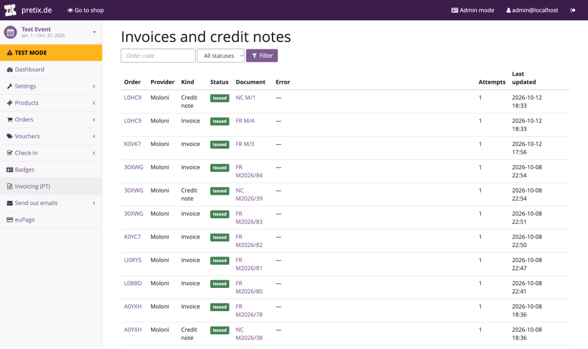
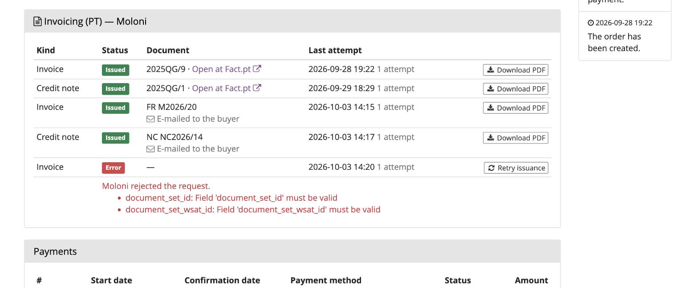
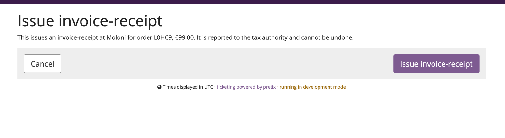

# Issuing & credit notes

## Automatic issuance

Once the plugin is configured, every order that becomes **paid** gets an invoice-receipt, issued in
the background by pretix's Celery workers. Unpaid orders are never issued, whatever triggers it. With
**Issue documents automatically** off, nothing is issued unless you press a button; see
[Manual-only issuance](configuration.md#manual-only-issuance).

!!! tip
    If Celery isn't running, tasks are only queued and rows stay in *Processing*.

## Dashboard

The **Invoicing (PT)** entry in the event's sidebar lists every issuance attempt: order, provider,
kind (invoice or credit note), status, document number, error, number of attempts and when it was
last updated. Filter by status or search by order code.



Each issued row's document number is a PDF download; each failed row has a **Retry** action. The
number is the one printed on the document, e.g. `FR M2026/20` for Moloni or `2025QG/9` for Fact.pt.

| Status | Meaning |
|---|---|
| **Issued** | The provider created the document. The number and PDF are available. |
| **Processing** | A worker is on it, or the task is still queued. |
| **Error** | The attempt failed; the error column says why. Press **Retry** once the cause is fixed. |

## The order page panel

Every order in the Control panel gets an **Invoicing (PT)** panel, with one row per document,
oldest first: every invoice and credit note the order ever had, each with its status, number, the
time of the last attempt, whether it was e-mailed to the buyer, and a **Download PDF** button.


The actions on it:

- **Issue invoice now** — for a paid order without a successful invoice. Use it for orders paid
  before the plugin was configured, orders marked paid by hand while automatic issuance is off, or
  an order [paid again after a refund](#paid-again-after-a-refund).
- **Retry issuance** — on an invoice row in *Error*, after fixing whatever the provider rejected.
- **Issue credit note** / **Retry credit note** — available once the invoice was issued successfully,
  whether or not pretix has a refund on record.
- **Open at Fact.pt** — a link to the document's page at the provider, when it offers one.

A failed row shows the provider's message underneath, with per-field details when the provider
returned them:



Every action goes through a **confirmation page** first, since an issued document is reported to the
tax authority and can't be undone. It names the provider, the order and the amount:



The confirmation also refuses up front, with a message, anything the task would otherwise skip:
no provider selected, provider not configured or connection expired, order not paid, invoice
already issued, nothing left to credit, or an attempt already in progress.

!!! note "In progress"
    While a worker is on a document, the row says *In progress — reload in a moment* and has no
    button, so a second click can't issue twice. A row stuck in *Processing* for more than ten
    minutes (a worker that died mid-task) can be retried.

If the provider isn't configured, or its Moloni connection has expired, the panel stays visible with
a warning and a link to the settings instead of its buttons.

## Two kinds of failure

| Failure | Example | What happens |
|---|---|---|
| **Rejected by the provider** | invalid NIF, VAT mismatch, bad token, missing exemption reason | Marked *Error* with the provider's message. Never retried automatically: fix the data or settings, then press **Retry**. |
| **Network / provider down** | timeout, unreachable | Also marked *Error*. With **Fact.pt** the task retries by itself, up to three times a couple of minutes apart (*retrying automatically in a few minutes*, then *gave up after several attempts*); Fact.pt rejects a duplicate, so this is safe. With **Moloni** it is never retried automatically: the row says *the document may or may not have been created*, and you check in Moloni before pressing **Retry**. |
| **Provider not configured** | expired Moloni connection, missing token | Recorded as an *Error* row reading *Not issued: … is not fully configured, or its connection has expired*, so the paid order is never silently skipped. Fix the settings, then **Retry**. |

## Credit notes

A credit note is issued **automatically** once an order's refunds add up to the full amount paid,
whether that takes one refund or several, and only counting refunds pretix marks as **done**. It
always credits the original invoice **in full**.

A **partial** refund that doesn't bring the order to zero issues nothing, because neither provider
can credit less than a whole document. You decide: issue a full credit note by hand from the order
page, or leave it. See [Known limitations](limitations.md).

## Paid again after a refund

An order can be paid, refunded and then paid again. Once the first invoice has been credited, the new
payment gets a **new invoice**, issued automatically like the first. A later full refund credits that
new invoice, never one that's already credited. The order panel keeps all of them, oldest first, and
shows *Paid again after the last invoice was credited* with an **Issue invoice now** button whenever
the order is paid and its latest invoice is credited.

If the new payment arrived before the credit note was issued, nothing is issued for it on its own.
Use **Issue invoice now** once the credit note exists.

## Billing changes

If the buyer edits their invoice address after the invoice was issued, the panel shows a warning and
the event's contact address is e-mailed; nothing is re-issued without you. See
[Billing changes after invoicing](configuration.md#billing-changes-after-invoicing).

## Buyer-facing


- **Order page** — a **Download invoice** button beside the ticket downloads once the document
  exists, and **Download credit note** once that exists too (if **Show the invoice on the buyer's
  order page** is on). Authenticated by the order's secret link, like pretix's own downloads. Only
  documents issued by the event's current provider are offered.
- **E-mail** — the PDF as an attachment, if enabled under [E-mail](configuration.md#e-mail).
  Issuing by hand from the Control panel sends it too.

## Bulk issuance

Issuance by hand is one order at a time, on purpose. For a backlog (orders paid before the plugin
was set up), loop the task from a shell; orders that already have a successful invoice are skipped:

```python
# python -m pretix shell
from django_scopes import scopes_disabled
from pretix.base.models import Order
from pretix_ptinvoicing.tasks import issue_invoice

with scopes_disabled():
    for order in Order.objects.filter(event__slug="my-event", status=Order.STATUS_PAID):
        issue_invoice.apply(kwargs={"order_pk": order.pk, "event_pk": order.event.pk})
```
